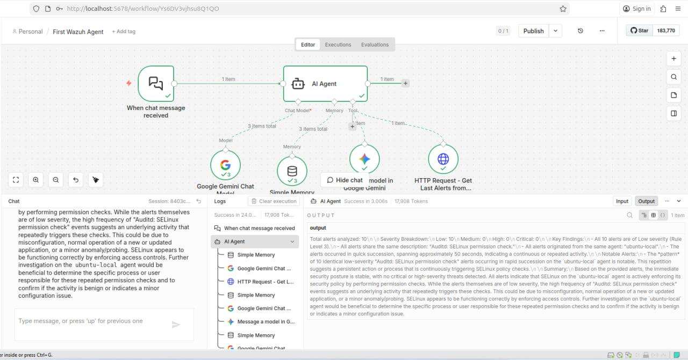
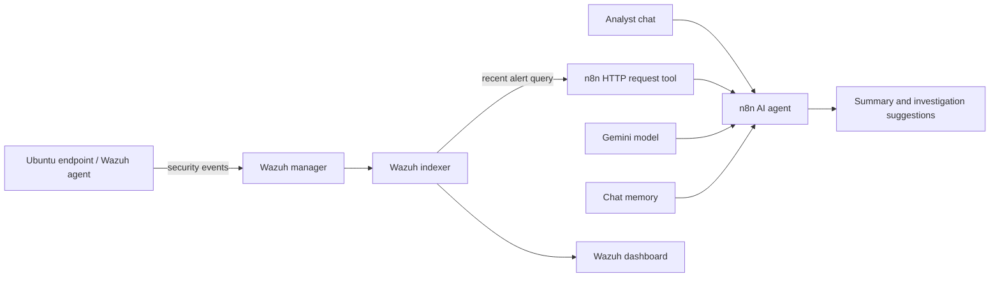

# AI-Assisted Security Operations Lab

**A hands-on VMware / Ubuntu lab connecting Wazuh alerts to an n8n AI agent for analyst-friendly triage.**

## Demonstration

[](assets/wazuh-agent-demo.mp4)

## Demo Video

https://github.com/user-attachments/assets/4c29436c-fdb1-467f-8771-f48d69f150c8


## Project overview

This lab brings together endpoint monitoring, security event analysis, and AI-assisted automation in an Ubuntu virtual environment. Wazuh collects and indexes security alerts, while an n8n workflow retrieves recent events and uses Gemini to produce a structured summary for analyst review.

The demonstrated workflow combines an n8n chat trigger, AI Agent, Google Gemini Chat Model, Simple Memory, a Gemini tool, and an HTTP Request tool for recent alerts. The response summarizes 10 low-severity audit-related events for an Ubuntu agent. This is an observed example, not a benchmark or proof of an attack.



## Technical capabilities

- Connecting endpoint telemetry, Wazuh detection, and indexed security alerts.
- Working with the Wazuh Indexer API, HTTPS, authentication, and query filtering.
- Designing an n8n chat workflow with an AI model, memory, and a read-only HTTP tool.
- Interpreting repeated low-severity audit events and separating evidence from inference.
- Documenting a reproducible security lab and protecting credentials before publication.

## Repository guide

| Path | Purpose |
| --- | --- |
| [docs/setup.md](docs/setup.md) | Prerequisites, deployment, configuration and verification |
| [docs/configuration.md](docs/configuration.md) | Networking, credentials, TLS and operational checks |
| [docs/workflow.md](docs/workflow.md) | Rebuild and validate the demonstrated n8n workflow |
| [docs/investigation.md](docs/investigation.md) | Example investigation and evidence limits |
| [docs/course-notes.md](docs/course-notes.md) | Course topics, attribution and lab boundaries |
| [docs/publishing.md](docs/publishing.md) | Export, sanitize and upload to GitHub |
| [queries/recent-alerts.json](queries/recent-alerts.json) | Bounded recent-alert indexer query |
| [tools/query_alerts.py](tools/query_alerts.py) | Optional standard-library indexer query client |
| [examples/synthetic-response.json](examples/synthetic-response.json) | Clearly labeled offline test data |
| [assets/n8n-agent.png](assets/n8n-agent.png) | Screenshot supplied with the project |
| [assets/wazuh-agent-demo.mp4](assets/wazuh-agent-demo.mp4) | User-supplied demonstration recording |

## Quick start

1. Follow [setup](docs/setup.md) and make sure Wazuh and n8n are running inside the isolated lab.
2. Check connectivity to the indexer using [the query guide](docs/workflow.md); use a read-only account and a trusted CA.
3. Configure the n8n agent and credentials following the workflow guide. Export your actual working workflow after sanitizing it; this repository does not contain your original n8n export.
4. Ask: **“Review the latest Wazuh alerts and summarize severity, evidence, and next steps.”** Compare the answer with Wazuh's original records.

To explore the query client without a running lab:

```bash
python3 tools/query_alerts.py --fixture examples/synthetic-response.json
```

## Scope and limitations

This is a learning lab, not a production SOC. An LLM can misunderstand events or follow malicious instructions embedded in logs. Treat returned alert text as untrusted, minimize data sent to model providers, and verify all findings against the source. The workflow is intended for analyst review; no automatic blocking or remediation is claimed. Setup varies by Wazuh and n8n version. Details unavailable from the provided screenshot must be confirmed in the actual VM.

## References and attribution

Project learning resources include [Atlantium AI's playlist](https://www.youtube.com/playlist?list=PLtyp1BBFawaz946JTxU1MOVZE13d37Yp7) and its [lab setup repository](https://github.com/Atlantium-AI/wazuh-n8n-lab-setup). Consult the [official Wazuh Docker guide](https://documentation.wazuh.com/current/deployment-options/docker/wazuh-container.html) and [n8n documentation](https://docs.n8n.io/) for current instructions.
